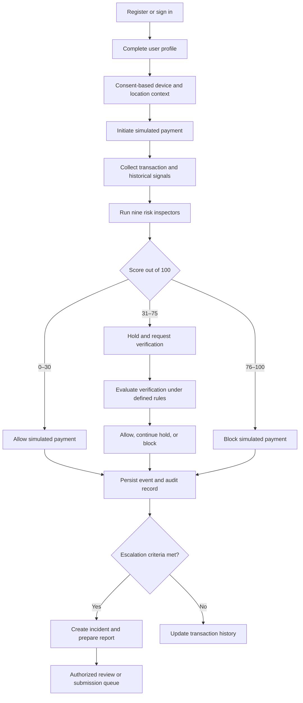
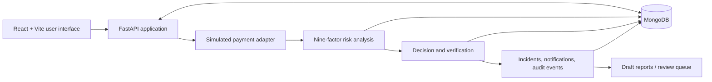

<div align="center">

# 🛡️ SecureFlow-AI

### Detect the anomaly. Verify the intent. Protect the payment.

**AI-Powered Digital Payment Fraud Detection, Adaptive Verification & Incident Response**  
**Team QuantumMinds**

[](https://github.com/soumadip-engage/SecureFlow-AI)


[**Explore the Code**](https://github.com/soumadip-engage/SecureFlow-AI) · [**System Architecture**](#system-architecture) · [**Run Locally**](#run-locally) · [**Development Roadmap**](#development-roadmap)

</div>

> **Prototype disclosure:** SecureFlow-AI is an educational/hackathon prototype using simulated payment flows and synthetic or historical development data. It does not intercept third-party UPI transactions, move real funds, perform certified biometric verification, or automatically submit complaints to authorities. Those actions require separately authorized integrations and appropriate safeguards.

## At a glance

SecureFlow-AI explores how payment security can act **before a transaction is approved**. A user initiates a simulated payment; the system evaluates transaction and behavioral context through **nine weighted risk inspectors**, calculates an explainable **0–100 score**, and applies an **allow / hold-and-verify / block** policy. Suspicious activity can be recorded for investigation and evidence-based report preparation.

The intended experience is **user-driven**, not a dashboard of pre-scripted payments. The repository is a work in progress: implemented APIs and screens should not be confused with independently verified end-to-end functionality.

## Contents

- [The problem](#the-problem)
- [Our approach](#our-approach)
- [What makes SecureFlow-AI different](#what-makes-secureflow-ai-different)
- [User journey](#user-journey)
- [Nine risk inspectors](#nine-risk-inspectors)
- [Decision and verification policy](#decision-and-verification-policy)
- [System architecture](#system-architecture)
- [Core modules](#core-modules)
- [Technology stack](#technology-stack)
- [Repository structure](#repository-structure)
- [Run locally](#run-locally)
- [API reference](#api-reference)
- [Data and simulation](#data-and-simulation)
- [Security privacy and limitations](#security-privacy-and-limitations)
- [Project status](#project-status)
- [Demonstration walkthrough](#demonstration-walkthrough)
- [Testing and validation](#testing-and-validation)
- [Development roadmap](#development-roadmap)
- [Team and acknowledgments](#team-and-acknowledgments)
- [Contributing and license](#contributing-and-license)

## The problem

Digital-payment fraud can exploit changes in transaction amount, payment timing, device, location, recipient, and account behavior. A payment may look ordinary in isolation but become concerning when these signals are considered together. Traditional single-rule alerts can also produce friction for legitimate users.

**Our objective** is to demonstrate a transparent, contextual pre-payment assessment: detect unusual activity, request proportionate verification when necessary, preserve an audit trail, and prepare actionable incident evidence without treating a risk score as proof of wrongdoing.

## Our approach

1. **Establish context:** build a user profile and use available, consented device/location signals and historical activity.
2. **Initiate a payment:** collect an amount, recipient, and purpose from the user.
3. **Inspect the attempt:** evaluate nine risk factors using structured inputs.
4. **Make a policy decision:** allow low risk, hold medium risk for verification, block high risk.
5. **Record the outcome:** retain transaction status, reasons, verification events, and relevant audit evidence.
6. **Escalate when justified:** prepare incident records and reporting packages for authorized human review or submission.

These are the **target product behaviors**. Their implementation and validation status is described below.

## What makes SecureFlow-AI different

| Capability | Why it matters |
|---|---|
| User-initiated payment analysis | Evaluates an actual submitted attempt instead of a preloaded dashboard event. |
| Nine-factor weighted scoring | Makes the contribution of each inspector visible and bounded. |
| Context-aware verification | A held payment can request information relevant to the dominant risk signals. |
| Historical behavior comparison | Treats earlier transactions as baseline evidence, not fabricated live activity. |
| Separate score and explanation layers | Keeps numeric scoring deterministic; language models may assist with wording, not choose the score. |
| Evidence-linked incident workflow | Connects blocked attempts, verification outcomes, and report drafts to source events. |
| Explicit integration boundary | Distinguishes a simulated payment adapter from future authorized bank/PSP integration. |

These are design goals and distinguishing choices, **not claims of unique industry-first capabilities**.

## User journey



**Onboarding design:** profile details, contact information, address, emergency contact, device registration, and optional camera-based verification are planned as a consent-aware sequence. Browser location requires permission; unavailable context must remain labeled unavailable. A camera capture alone is **not** proof of verified identity.

## Nine risk inspectors

The scoring specification assigns each inspector a fixed maximum. The total maximum is **100 points**.

| # | Inspector | Weight | Examples of evaluated signals |
|---:|---|---:|---|
| 01 | Amount risk | **10** | Deviation from usual amount; high-value and amount patterns |
| 02 | Time risk | **7** | Unusual hour; activity-window and timing changes |
| 03 | Frequency risk | **12** | Burst activity; sudden volume increases; repeated recipient attempts |
| 04 | New device risk | **15** | Unrecognized device; unfamiliar device association or characteristics |
| 05 | New/unusual location risk | **15** | New place; deviation from known locations; contextual combinations |
| 06 | Sudden location change risk | **6** | Distance, elapsed time, and implausible movement |
| 07 | Unknown beneficiary risk | **12** | First-time recipient; limited history; suspicious recipient patterns |
| 08 | No previous transaction history risk | **13** | Missing recipient, device/location, or comparable transaction history |
| 09 | Typical amount with beneficiary risk | **10** | Deviation from normal recipient amount or category |
| | **Maximum total** | **100** | |

### Score calculation

```text
risk_score = amount + time + frequency + device + unusual_location
           + location_change + beneficiary + history + beneficiary_amount

0 <= risk_score <= 100
```

Each contribution should be calculated from explicit inputs and documented rules. **Gemini or another generative model must not invent the numeric score.** AI-assisted text can explain flagged factors, propose verification wording, or draft readable incident summaries; those outputs must be checked against structured evidence.

## Decision and verification policy

| Risk score | Classification | Intended payment action |
|---|---|---|
| **0–30** | Low risk | **ALLOW** the simulated payment |
| **31–75** | Alert mode | **HOLD** and initiate contextual verification |
| **76–100** | High risk | **BLOCK** the simulated payment |

A verification response does not automatically clear a flagged transaction. The intended evaluator checks controlled evidence, records attempts, and makes a reproducible follow-up decision. Repeated blocks may trigger an incident and **draft** cybercrime/police reporting package. Report generation must not be represented as actual submission.

## System architecture



The diagram shows the **intended logical separation**; the current FastAPI implementation is concentrated in `backend/main.py`, not necessarily deployed as separate services. An authorized bank/PSP/UPI integration would be a future replacement for the simulated adapter, not a feature currently claimed by this repository.

## Core modules

| Module | Responsibility |
|---|---|
| User and profile | Profile data, registration context, and verification status |
| Transaction interface | User-entered payment details and transaction state |
| Context intelligence | Historical, device, network, location, and beneficiary signals |
| Risk engine | Weighted factor contributions and total score |
| Verification | Risk-specific questions and tracked responses |
| Decision engine | Allow, hold, block, and re-evaluation outcomes |
| Security operations | Notifications, incidents, audit trail, and SOC views |
| Reporting | Evidence-based draft reports for authorized review |

## Technology stack

| Layer | Technology | Role |
|---|---|---|
| Frontend | **React, Vite, JavaScript, CSS** | User interface and payment/security views |
| Backend | **Python, FastAPI, Pydantic** | HTTP APIs and application logic |
| Database | **MongoDB, PyMongo** | Application and historical records |
| Optional ML components | **scikit-learn** | Experimentation with anomaly/classification signals where configured and trained |
| Development | **Git, GitHub, VS Code** | Version control and local development |

The checked-in backend also has a Node `package.json`; the main API source identified in this repository is **`backend/main.py` (FastAPI)**. Firebase/Firestore and Gemini-assisted workflows are possible future integrations, **not confirmed production dependencies** of the checked-in implementation.

## Repository structure

```text
SecureFlow-AI/
├── README.md
├── .gitignore
├── backend/
│   ├── main.py                    # FastAPI application
│   ├── app/
│   │   └── database/
│   │       ├── mongodb.py         # MongoDB connectivity helper
│   │       └── test_mongodb.py    # Connectivity test script
│   ├── package.json
│   └── package-lock.json
└── frontend/
    ├── src/
    │   ├── App.jsx               # Main React interface
    │   ├── App.css
    │   ├── index.css
    │   ├── main.jsx
    │   └── assets/
    ├── public/
    ├── package.json
    ├── package-lock.json
    ├── vite.config.js
    └── index.html
```

This tree describes the files committed to the GitHub repository, not the larger untracked local ZIP contents or external database exports.

## Run locally

### Requirements

- Git
- Python and `pip`
- Node.js and npm compatible with the checked-in Vite version
- MongoDB Atlas or a reachable MongoDB instance

### 1. Clone the repository

```powershell
git clone https://github.com/soumadip-engage/SecureFlow-AI.git
cd SecureFlow-AI
```

### 2. Start the FastAPI backend

In the first PowerShell terminal:

```powershell
cd backend
python -m venv .venv
.\.venv\Scripts\Activate.ps1
python -m pip install -r requirements.txt
```

Create a **local-only** `backend/.env` with values appropriate to your deployment:

```dotenv
MONGODB_URI=your_mongodb_connection_uri
MONGODB_DB=SecureFlowDB
AUTO_TRAIN_ML=false
APP_ENV=development
ENABLE_DEMO_RESET=false
ADMIN_API_KEY=
```

```powershell
python -m uvicorn main:app --reload --host 127.0.0.1 --port 8000
```

- API documentation: `http://127.0.0.1:8000/docs`
- Health endpoint: `http://127.0.0.1:8000/health`

The tracked `backend/.env.example` documents the available settings. Python dependencies are specified with bounded version ranges, not a frozen lockfile. If PowerShell blocks activation, use `.\.venv\Scripts\python.exe` instead.

Privileged `/admin/*` operations and the report queue submission endpoint require a strong **server-side** `ADMIN_API_KEY` passed in the `X-Admin-Key` header. When unset, privileged operations are unavailable. Generate a key locally with `python -c "import secrets; print(secrets.token_urlsafe(32))"`; never place it in frontend code. Resetting demo data additionally requires `APP_ENV=development`, `ENABLE_DEMO_RESET=true`, and `X-Confirm-Demo-Reset: reset-operational-data`. Keep it disabled for Atlas-backed shared databases.

**Optional ML training using your 1-million-transaction synthetic CSV:**

```powershell
python -m ml.train_from_csv --csv "C:\path\to\secureflow_ai_1m_ml_training.csv"
```

The model is saved locally as `backend/models/secureflow_rf.joblib` (ignored by Git). Set `ML_MODEL_PATH=models/secureflow_rf.joblib` in `backend/.env` to load this **trusted, locally trained** artifact at startup. Do not load model files downloaded from unknown sources. The training script uses only explicit `is_fraud` labels, excludes precomputed scores and decisions, and by default assigns **whole user IDs** to disjoint training/validation/test sets with a reproducible hash. Validation/test performance remains synthetic-only, not a real-world fraud-detection guarantee or calibrated real-world fraud probability.

The training output also includes a **user-overlap audit**. The supplied CSV's original split reuses **7,809 of 7,814 test users** in training, which makes an original-split evaluation optimistic for unseen users. The default `--split-strategy user-disjoint` avoids that overlap; pass `--split-strategy provided` only to reproduce the original synthetic split, with its limitation clearly disclosed. Neither evaluation is independent real-world validation. If the supervised model is not explicitly loaded, `/health` and the web UI report **rules-only mode** and no fabricated ML fraud probability.

**Reproducible synthetic benchmark (40-tree demonstration run, seed 42):** the user-disjoint test split contained **148,750 transactions / 310 fraud labels / 1,512 unseen users**. Precision was **89.66%**, recall **83.87%**, and F1 **86.67%** (30 false positives, 50 false negatives). No training users appeared in validation/test. Reproduce with `--trees 40`; these results are **not** independently verified real-world performance and the estimated probabilities have not been calibrated on real payments.

### 3. Start the frontend

In a **second** terminal, from the repository root:

```powershell
cd frontend
npm ci
npm run dev
```

Open the local URL printed by Vite, commonly `http://localhost:5173`. The inspected frontend expects the API at `http://127.0.0.1:8000`; keep that port available unless you update the frontend configuration.
For separate deployments, copy `frontend/.env.example` to `.env.local` and change `VITE_API_URL`. Vite config is public in the browser; never put credentials there.

## API reference

Selected routes present in the inspected FastAPI source:

| Method | Endpoint | Purpose |
|---|---|---|
| `GET` | `/health` | Service health |
| `GET` | `/users` | User records |
| `GET` | `/users/{user_id}` | User details |
| `GET` | `/transactions/{user_id}` | User transaction history |
| `POST` | `/analyze-payment` | Payment risk analysis |
| `POST` | `/verify-challenge` | Submit verification response |
| `GET` | `/verify-challenge/{session_id}` | Verification session details |
| `POST` | `/verify-identity` | Prototype identity-verification workflow |
| `GET` | `/notifications/{user_id}` | Notification records |
| `GET` | `/security-events/{user_id}` | Security event history |
| `GET` | `/incidents` | Incident records |
| `GET` | `/reports` | Reporting records |
| `GET` | `/soc/dashboard` | SOC summary |
| `GET` | `/soc/live-feed` | SOC event feed |
| `GET` | `/risk-weights` | Risk weight configuration |

**Presence in source is not proof of operational readiness.** Inspect the generated `/docs` page and validate endpoints against the configured database before a live demonstration.

## Data and simulation

The project uses synthetic/historical data to support behavior baselines and development tests. The team also maintains separate SQLite development datasets; these are **not included in this public repository**. A migration to MongoDB or another store should preserve source data, IDs, relationships, and record counts, with explicit verification after import.

**Data principles:**

- Historical records are historical; do not label them as real-time user payments.
- A new payment attempt must be derived from the user's input and the available context.
- Test scenarios should change **input signals**, not directly assign a convenient score.
- Missing device, location, or baseline information must remain explicitly unknown.
- Synthetic records and test accounts must be clearly identified as such.

## Security privacy and limitations

- **Authentication and access control:** restrict user data, admin/SOC functions, and sensitive API endpoints before public deployment.
- **Secrets:** keep `.env`, MongoDB connection strings, tokens, service-account files, and private keys outside Git history.
- **Consent:** obtain meaningful permission before collecting camera, precise location, or emergency-contact details. Minimize retention and avoid unnecessary biometric storage.
- **IP and location:** browser access is limited; a public IP is not an exact physical location. Do not claim precise location or device identity without a reliable, authorized source.
- **Risk interpretation:** a high score indicates a policy concern, not confirmed fraud or guilt.
- **ML ground truth:** an `ALLOW`, `HOLD`, or `BLOCK` decision is not a fraud label. Supervised learning requires an explicit `is_fraud`/`fraud_label` field. The rule engine remains authoritative for high-risk blocks; ML cannot downgrade its score.
- **Identity:** the sample UI and API do not perform verified biometrics. Client-provided face scores and identity flags are never trusted as proof of identity.
- **Access control:** only privileged admin operations are protected by a server-side admin key so far. End-user authentication, user-level authorization for profile/transaction data, and dedicated SOC roles remain **required before any public or production deployment**. The backend denies user-facing demo APIs when `APP_ENV` is not `development`, until real authentication is implemented. Do not expose development mode publicly or use it with real customer data.
- **External reporting:** a generated report is a **draft**, not a filed police/cybercrime complaint. Actual submission needs an approved channel, appropriate legal basis, and safeguards against false reports.
- **Real payments:** the prototype cannot intercept or authorize arbitrary third-party UPI payments.

## Project status

**Active prototype — under development.** The inspected repository includes a React/Vite frontend, a Python/FastAPI backend, MongoDB helper code, risk-weight definitions, and payment-analysis, verification, incident, reporting, and SOC API routes.

| Area | Status | Notes |
|---|---|---|
| Frontend and backend source | **Present** | React/Vite and FastAPI code committed |
| MongoDB integration code | **Present** | Requires working credentials and connectivity |
| Risk weights and analysis endpoints | **Present in source** | Full scenario testing still needed |
| Verification and incident routes | **Present in source** | End-to-end behavior not independently validated |
| User-first onboarding and live simulation | **Target workflow** | Verify implementation against the intended journey |
| Production biometric verification | **Not established** | Requires authorized provider and security review |
| Authorized UPI/PSP payment integration | **Not integrated** | Prototype uses simulation |
| Police/cybercrime submission | **Not integrated** | Draft/reporting workflow only |
| Production security audit and deployment | **Not verified** | Do not assume production readiness |

## Demonstration walkthrough

For a hackathon presentation, the **implemented demo path** is:

1. Open the web UI and confirm the **Interactive Sandbox** banner and **Engine Connected** status. If MongoDB is offline, fix the connection before demonstrating.
2. Select a synthetic user. The **Demo Playbook** provides **Everyday payment**, **New device**, and **High-value anomaly** presets. These populate inputs from available user history; they do not preset a decision.
3. Click **Analyze Payment** and explain the 0–100 score, **nine bounded factor bars** and expandable underlying signals. A factor scored 10/10 now fills its bar completely.
4. Compare two or three scenarios. The actual result depends on that user's data: the intended **ALLOW / VERIFY / BLOCK** outcomes are calculated, not scripted. When verification is requested, answer the server-selected question and show the new decision.
5. Scroll to **Transaction History**: the newly analyzed attempt appears alongside synthetic records. Only allowed/monitored operational attempts inform future behavior baselines; blocked and pending attempts remain visible but do not become trusted behavior.
6. Show `/health` for honest ML/DB status; inspect an incident and draft report if a block triggers them.

There are no real transfers, certified biometric checks, or automatic government reports. A sample payment can legitimately score high or low depending on the selected user's history. For the recommended stage script see [DEMO_GUIDE.md](DEMO_GUIDE.md).

## Testing and validation

Before demonstrating or deploying, verify at least the following:

- **Risk boundaries:** scores 0, 30, 31, 75, 76, and 100 produce the expected policy decisions.
- **Inspector bounds:** each contribution stays within its specified maximum; total stays within 0–100.
- **Context changes:** changing amount/device/location/recipient inputs changes the appropriate factors, not a hardcoded score.
- **Verification:** incorrect, expired, or repeated responses do not automatically approve a payment.
- **Data isolation:** users cannot retrieve another user's transactions; admin/SOC routes require authorization.
- **Persistence:** every created attempt and decision has consistent IDs and traceable timestamps.
- **Reporting:** incident drafts reference real stored evidence and are never marked as submitted without confirmation.

Run these checks locally before each demonstration:

```powershell
cd backend
python -m unittest discover -s tests -v
cd ..\frontend
npm ci
npm run lint
npm test
npm run build
```

The checks also run in GitHub Actions on pull requests. They exercise security boundaries and important calculations without accessing MongoDB Atlas. They are not a substitute for full integration tests or security certification.

## Development roadmap

- [x] Create the frontend/backend repository structure
- [x] Define the nine weighted risk factors and decision thresholds
- [x] Add initial analysis, verification, SOC, incident, and reporting API routes
- [ ] Validate complete onboarding → payment → inspection → decision journey
- [ ] Test deterministic risk factors and boundary cases
- [ ] Strengthen user authentication, permissions, consent, and data retention
- [ ] Verify historical-data migration and per-user behavior baselines
- [x] Add initial backend regression tests, frontend lint/build checks, CI, and Python dependency ranges
- [x] Protect privileged reset/retrain operations and reject client-supplied biometric proof
- [x] Support explicit-fraud-label training and offline CSV model evaluation
- [x] Show honest sandbox/health/ML status and correctly scaled explainable risk contributions
- [x] Provide selectable demo payment scenarios without hardcoded decisions
- [x] Prevent client-invented beneficiary IDs from bypassing recipient trust checks
- [x] Include operational payments in history while excluding blocked/pending attempts from user baselines
- [x] Audit training/validation/test user overlap and test the new frontend presentation logic
- [ ] Add authentication and authorization for every user's records and SOC role
- [ ] Refactor large application files into focused services and components
- [ ] Harden audit evidence and reporting review/approval workflows
- [ ] Explore authorized bank/PSP integration where legally and technically possible

## Team and acknowledgments

**Team QuantumMinds**

| Member | Project involvement |
|---|---|
| **Soumadip Das** | Team Lead |
| Shubham Paul | Team member |
| Shubham Mukherjee | Team member |
| Tridip Debroy | Team member |

SecureFlow-AI is developed as a collaborative learning and hackathon project. Thanks to the open-source ecosystem behind React, FastAPI, MongoDB, and associated developer tools. Product and service names are used for identification only; they do not imply endorsement.

## Contributing and license

Suggestions and pull requests are welcome. For contributions, describe the intended change, keep code and documentation aligned, and avoid committing credentials or sensitive personal data. Security issues should be reported privately to the maintainers rather than disclosed with exploitable details in a public issue.

**License:** No license is asserted here. Check the repository for an actual `LICENSE` file before assuming reuse or redistribution rights.

---

<div align="center">

**SecureFlow-AI** · Context-aware payment security, built by **Team QuantumMinds**  
*Prototype for research, education, and hackathon demonstration — not a live payment or law-enforcement service.*

</div>
